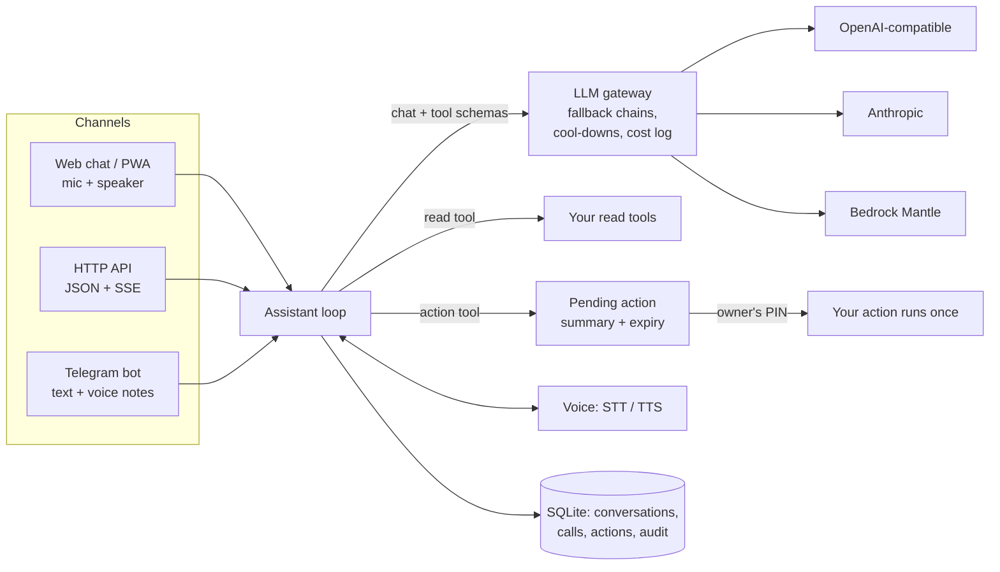

# IRA

**Hey Ira.** A self-hosted voice assistant over your own data and tools.

You register a few Python functions: *read tools* that look things up, and
*action tools* that change something. Ira answers questions about your
business by text or voice, on the web, over an API or on Telegram. When a
request needs a change, Ira **proposes** it, and your code runs it only after
the owner confirms with a PIN.

It works with any LLM provider (OpenAI-compatible endpoints, the Anthropic
Messages API, Amazon Bedrock), falls back down a chain of models when one is
down or busy, and logs the cost of every call. With no API key at all it runs
a keyword-routing demo, so you can try it in a minute.

```text
You:  any free slots tomorrow afternoon?
Ira:  Tuesday has 14:00, 14:30, 15:30 and 16:30 free.
You:  book Jamie Example at 14:30
Ira:  I've proposed: Book Jamie Example on Tuesday 13 October at 14:30.
      It needs your PIN.          [ PIN ____ ] [Confirm] [Cancel]
```

## Why

A small business does not need a chatbot that can do anything. It needs one
that knows *its* calendar, stock or orders, answers by voice when the owner's
hands are busy, and cannot change anything without the owner saying so.
IRA keeps three things apart:

1. **The model decides what to look up and what to propose.**
2. **Your code does the work**, through ordinary typed Python functions.
3. **The owner holds the PIN.** Nothing changes without it, and the PIN never
   passes through a model.

## Architecture in 20 seconds



More in [docs/architecture.md](docs/architecture.md).

## Quickstart (no API key)

```bash
git clone <this repository> ira && cd ira
python -m venv .venv && source .venv/bin/activate
pip install -e .

cd examples/clinic          # Sunrise Dental Clinic, a fictional practice
ira demo seed               # made-up appointments in ./data/clinic.db
ira setup                   # create the owner account (email + password)
ira pin set                 # the PIN that releases actions
ira serve                   # http://127.0.0.1:8765
```

Open <http://127.0.0.1:8765>, sign in, and try:

- `what are the clinic hours?`
- `find slots tomorrow`
- `show appointments for Avery`
- `cancel appointment 3`, then type your PIN in the card

The demo provider is a keyword router, not a language model, so phrase things
plainly. To use a real model, add a provider and put it first in the tier
(see [examples/clinic/README.md](examples/clinic/README.md)):

```yaml
models:
  providers:
    openai: { type: openai, api_key_env: OPENAI_API_KEY }
    demo:   { type: fake }
  tiers:
    default: [openai:gpt-4o-mini, demo:router]
```

The key goes in your environment or a `.env` file, never in `ira.yaml`.

## Start a business folder

```bash
ira init ~/ira/shop --business "Example Shop, a hardware store"   # the demo router, no key
ira init ~/ira/clinic --provider bedrock --port 8811              # Amazon Bedrock and Polly
ira doctor ~/ira/clinic                                           # is it ready?
```

`ira init` writes a commented `ira.yaml`, a `tools.py` with one read tool and
one action tool to replace, and a README, and never a secret. `ira doctor`
checks the config, the data folder, the port, each tool module, one tiny call
to each model and voice, the owner's PIN and `public_url`, and exits non-zero
when anything fails; `--no-models` makes no calls. To run several businesses
on one small AWS server, see
[AWS with Bedrock](docs/deployment.md#aws-with-bedrock).

## Write your own tools

```python
from typing import Annotated
from pydantic import Field
from ira import ToolError, action, tool


@tool
def stock_level(sku: Annotated[str, Field(description="Product code")]) -> dict:
    """How many of a product are in stock."""
    return {"sku": sku, "in_stock": 12}


def _reorder_summary(sku: str, quantity: int) -> str:
    if quantity > 500:
        raise ToolError("orders over 500 units go through the buyer")
    return f"Order {quantity} more of {sku}"


@action(summary=_reorder_summary)
def reorder(sku: str, quantity: int) -> dict:
    """Place a supplier order. Runs only after the owner's PIN."""
    return {"ordered": quantity}
```

List the file under `tools:` in `ira.yaml`. The argument types become the JSON
schema the model sees and the validation Ira applies, from the same object.

## Channels

| Channel | What it does |
| --- | --- |
| **The Ira app** (`/`) | Tap the voice mark to talk, or type. Streamed answers, each with "How Ira got this"; the PIN card for actions; spoken replies; today's conversations. Installable on a phone. |
| **HTTP API** (`/v1`) | `POST /v1/ask`, `/v1/ask/stream` (SSE), `/v1/voice/transcribe`, `/v1/voice/speak`, `/v1/actions/{id}/confirm`. OpenAPI at `/v1/docs`. |
| **Admin console** (`/admin`) | Today at a glance, conversations and transcripts, actions, tools, models and voice, channels, users and roles, tokens and security, audit and cost. See below. |
| **Admin API** (`/v1/admin`) | What the console uses: calls, cost, latency, conversations, actions, tools, channels and the audit log; and, from a signed-in session, invitations and roles, API tokens, tool switches and tests, model chains and tests, settings and sessions, each recorded in a change log. |
| **Telegram** | Long polling, paired with a one-time code. Text and voice notes in; text, and voice when TTS is set up, out. `/name` renames the assistant. |

Voice: speech-to-text through an OpenAI-compatible chat model with
`input_audio` (for example Voxtral on Bedrock) or Whisper; text-to-speech
through Amazon Polly or OpenAI. Answers are shortened before they are spoken:
markdown, tables and links are stripped, and a long answer is cut at a
sentence with "Full details are in the text above."

## Your own Ira

IRA is also a personal assistant, for anyone who runs it or has an account
on a shared server. Install **Ira for Mac**, pair it, and Ira can use your
Mac when you ask: find a file and read it to you, read the window in front,
list your browser tabs, look up a contact, check your calendar:

```text
You:  vo PDF kahan hai jo kal download kiya?
Ira:  invoice-42.pdf, in Downloads, downloaded yesterday at 18:20.
You:  padh kar sunao
Ira:  Sunrise Dental Clinic, invoice 42: two check-ups and a cleaning...
You:  Chrome mein kya chal raha hai?
Ira:  Chrome has 3 tabs: Inbox, Upload - Example Drive, Build #812.
```

- **Devices** pair with a one-time code or QR code, hold one WebSocket each,
  and offer tools only to their own person, only with the skills they
  switched on (with their PIN). See [Devices](docs/devices.md).
- **Ira for Mac**, a menu-bar app (Option-Space), pairs in the app, keeps its
  key in the Keychain, talks by voice or text, and offers files, the screen,
  browser tabs, contacts, calendar, reminders, mail, notes, messages, apps,
  Shortcuts and coding tasks, each behind a skill and a tier. See [Ira for
  Mac](docs/clients/macos.md).
- **Ira for Windows**, a tray app (Ctrl+Alt+Space), pairs with a link or a
  code, keeps its key in Windows Credential Manager, and offers files, the
  screen's text, browser tabs, apps and the clipboard, each behind a skill
  you allow on the PC too, and Drop. See [Ira for
  Windows](docs/clients/windows.md).
- **Web and news search** through the Brave Search API and RSS feeds, with
  sources named by site and date.
- **Tiers**: reading runs at once, small changes are reported, outward ones
  wait for your "yes", and money, deletion or a new grant wait for your PIN.
  What a page or a device says is data, never an order.
- **Privacy**: what Ira did, without contents; export and delete your data.
  See [Privacy](docs/privacy.md).

Start with [Your own Ira in 15 minutes](docs/personal-assistant.md).

## The admin console


`/admin` is where the owner and the developer run Ira. It is a React app
built into the package, so `pip install` is all it takes.

- **Setup wizard** on first run, from the one-time link `ira serve` prints:
  the owner's account, the assistant's name and voice, which model keys the
  server has, the action PIN, channels.
- **Today**: questions, model calls, failures, cost, p50 and p95 latency, a
  by-model table, actions by status and channel health.
- **Conversations** with the full transcript: every tool call, its
  arguments and the data it returned.
- **Actions**: who proposed each one, who confirmed or cancelled it and when,
  the parameters and the result, and which roles may confirm it.
- **Tools**: read or action, the schema, an on/off switch, and "Test this
  tool" for read tools (never for actions).
- **Models and voice**: each tier's fallback chain, reorderable; provider
  and key status (set or missing, never the value); "Test this model" with
  latency; the assistant's name and voice.
- **Channels**: the web app, the HTTP API, Telegram pairing, and how to
  install the app on a phone.
- **Users and roles** (owner only): invite by link, change a role, remove a
  user, reset a PIN. The last owner cannot be removed or demoted.
- **Tokens and security**: API tokens with scopes, shown once; signed-in
  devices; your own PIN; the PIN lock and the rules from `ira.yaml`.
- **Audit and cost**: the change log (who did what), the action audit log,
  cost per day and every model call.

Every screen works on a phone, in light and dark, and shows plainly what
your role cannot do. The design tokens are shared with the Ira app in
[src/ira/web/static/tokens.css](src/ira/web/static/tokens.css).

## Safety model

- **Actions are proposals.** An action tool call stores a pending action with
  a human summary, the validated parameters and a 120-second expiry. It does
  not run.
- **A PIN releases it, once.** Each person has their own PIN, stored as a
  salted PBKDF2 hash, and `ira.yaml` says which roles may confirm each action.
  A database compare-and-set moves the action from `pending` to `executing`,
  so two confirmations cannot run it twice. Three wrong PINs lock all actions
  for 15 minutes. Every outcome is written to the audit log.
- **The PIN never reaches a model.** A message that is only a PIN is refused
  by the assistant on every channel; on Telegram it is deleted from the chat
  with `deleteMessage` before anything else happens.
- **Accounts and roles.** Owner, admin, staff and viewer. Passwords use
  Argon2. API tokens belong to a user and carry scopes that can only narrow
  the role: a phone token with scope `ask` can only ask.
- **No secrets in config.** `ira.yaml` names environment variables; keys are
  never logged, and errors are scrubbed of them before they are raised.

Details in [docs/security.md](docs/security.md).

## Security: keeping secrets out of this repository

This repository is public, so it guards itself:

- `.gitignore` excludes `.env*` (except `.env.example`), databases, `data/`,
  logs, keys and build output.
- `pre-commit` runs `detect-secrets` (with a reviewed baseline), `ruff`, a
  private-key detector, a **deny-list** check and an **identity** check.
  - The deny-list lives *outside* the repository
    (`~/.config/ira/denylist.txt`, or `$IRA_DENYLIST`): one literal or
    `re:regex` per line. A staged file that matches is refused, and the
    report shows `file:line` with a masked preview, never the match itself.
  - The identity check refuses a commit whose author or committer email is
    not a GitHub no-reply address.
- CI runs ruff, the tests on Python 3.11 and 3.12, the console's typecheck,
  tests and build (and checks the committed build matches the source), and
  **gitleaks** over the full history. CI holds no cloud, chat or model
  credentials: every test uses fakes.
- Demo data is fictional: 555-01xx numbers and `example.com` addresses.

## Built from a production assistant

IRA is a clean-room rewrite of a voice assistant the author runs every day
over a private operations system. Some lessons from running it are built in:

- **Replay bad tool arguments as `{}`.** Models sometimes emit arguments that
  are not a JSON object. Replaying them verbatim makes every provider reject
  the rest of the conversation, so the tool result explains the error and the
  history carries `{}`.
- **Delete the PIN, don't just ignore it.** A PIN typed into a chat stays in
  the chat's history unless the bot deletes it.
- **Tell the transcriber not to translate.** Speech models asked to
  "transcribe" will sometimes translate or answer instead. The prompt says
  so plainly, and a vocabulary hint fixes names they have never heard.
- **Expect capacity refusals.** Hosted models say "busy" often enough that a
  fallback chain with a short cool-down is the difference between a tool you
  trust and one you don't.
- **Decode voice notes yourself.** Some speech endpoints accept WAV or MP3 but
  not the OGG/Opus that Telegram sends.

## Roadmap

- **v0.3**: devices (done: Ira for Mac, search); coding and
  research tasks run on your Mac with no push; the Android "ear" with an
  on-device "Hey Ira" wake word; learning your routines with your consent;
  then voice ID. Also a Siri Shortcut endpoint, WhatsApp, a Docker image, and
  an evaluation harness run against every provider in a tier.

## Project

- Docs: [docs/](docs/index.md) (MkDocs-ready)
- Contributing: [CONTRIBUTING.md](CONTRIBUTING.md)
- Reporting a vulnerability: [SECURITY.md](SECURITY.md)
- Licence: [MIT](LICENSE)

The Python distribution is `ira-assistant` (the name `ira` is taken on PyPI);
the import name and the command are `ira`.
