# Admin guide

The admin console at `/admin` is where the owner and the developer run Ira.
It works on a phone and on a laptop, in light and dark, and every screen
shows plainly what your role cannot do. Everything it does goes through the
[Console API](api.md#console-api), and the `ira` command on the server does
the same jobs without a browser ([below](#from-the-command-line)).

## Signing in and roles

Sign in at `/admin` with the account the owner created or invited you to.
Staff use the Ira app at `/` instead: the console is for owners, admins and
viewers.

| Role | In the console | In the Ira app |
| --- | --- | --- |
| owner | everything, including Users & roles | asks, confirms with a PIN |
| admin | everything except Users & roles | asks, confirms with a PIN |
| staff | nothing (sent to the app) | asks, confirms with a PIN |
| viewer | reads every screen; changes nothing | nothing |

A control the role cannot use stays visible but disabled, with the reason
next to it. The server checks every request as well.

## First-run setup

`ira serve` prints a one-time link to `/admin/setup#code=…` while no account
exists. The wizard creates the owner's account, then walks through the
assistant's name and voice, the model keys the server has, your action PIN
and the channels. It can be closed and resumed. The steps are in
[Getting started](getting-started.md#set-up-from-the-browser-the-setup-wizard).

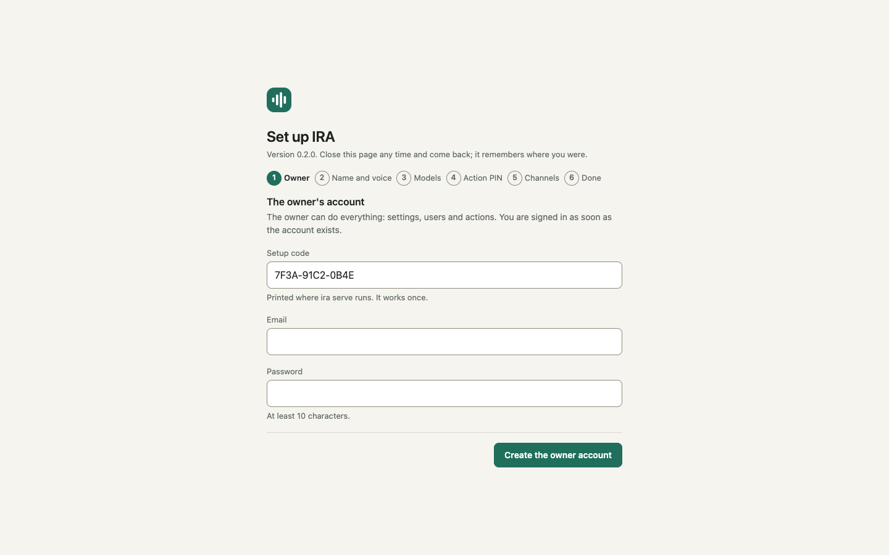

## Today

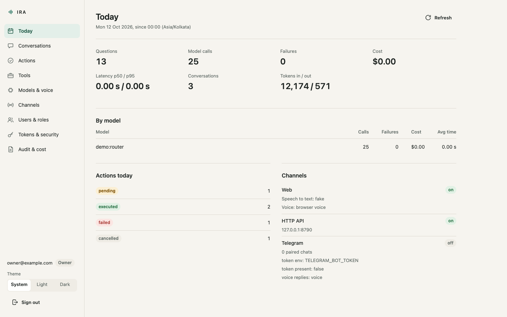

What Ira did today, since midnight server time: questions asked, model
calls (one for each attempt, so a model that failed before another answered
counts against itself), failures, cost in US dollars (from the price table
in `ira.yaml`, with how many calls' cost is unknown),
p50 and p95 latency in seconds, conversations and tokens; a table per model;
actions by status (each a link into Actions); and whether each channel is
on. Refresh re-reads everything.

## Conversations

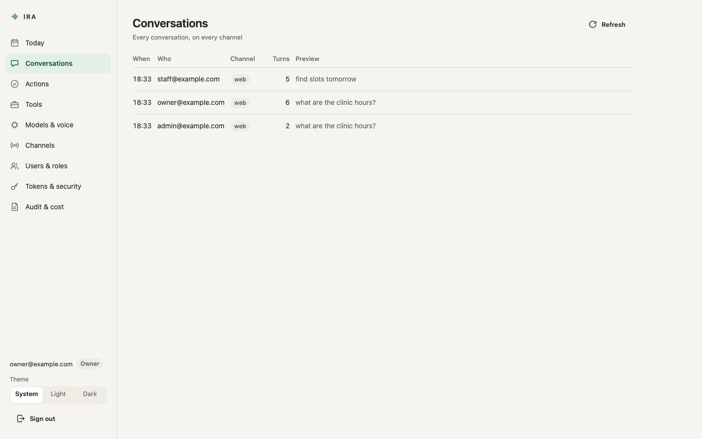

Every conversation on every channel, newest first, with who had it and a
preview. Open one for the transcript: each turn, and between the turns every
tool Ira called with its arguments and what the tool returned. This is the
same data the app's "How Ira got this" shows the person who asked.

## Actions

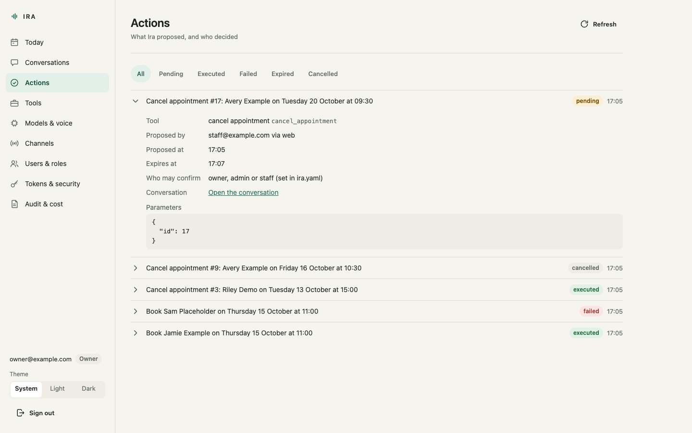

Everything Ira proposed, filtered by status: pending, executed, failed,
expired or cancelled, with a count on each filter. Each action opens to show
the tool, who proposed it and from where, who confirmed or cancelled it and
when, the parameters, the result (or the error), and which roles may confirm
it. Those roles come from `ira.yaml`; the console shows them and never
changes them. A proposal nobody confirmed within its two minutes is shown as
expired.

## Tools

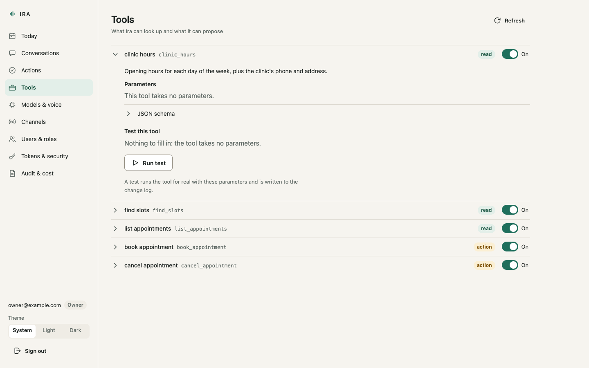

Every registered tool, read or action, with its description and parameters.
The switch takes a tool away from the model without unregistering it; a
pending action for a switched-off tool fails instead of running. Read tools
have **Test this tool**: a form built from the tool's schema, which runs the
tool for real and shows the result and the time it took. Tests are written to
the change log. Action tools never have a test button: they only run through
Ira, after a PIN.

## Models and voice

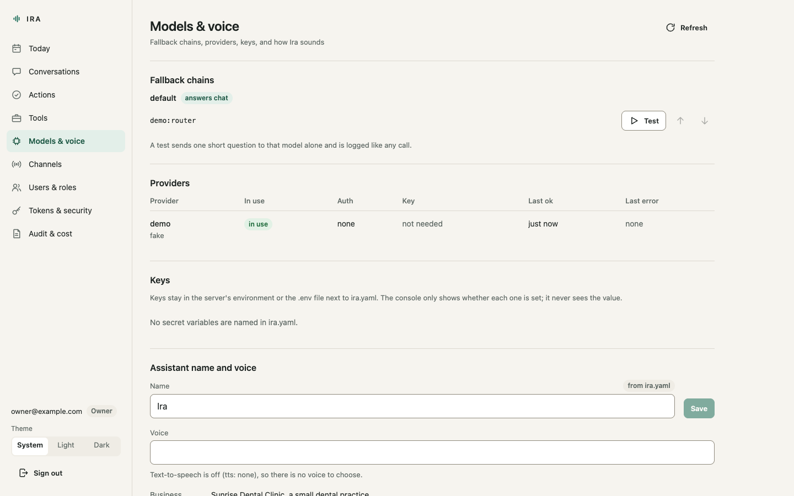

Each tier's fallback chain, which you can reorder (or reset to what
`ira.yaml` says); models on a cool-down are marked. **Test this model**
sends one short question to that model alone and reports ok and the latency;
it is logged like any call. Providers show whether their key variable is set
in the server's environment: the console never sees a key's value. The
assistant's name and, when text-to-speech is on, its voice can be changed
here; both take effect at once and are written to the change log.

## Channels

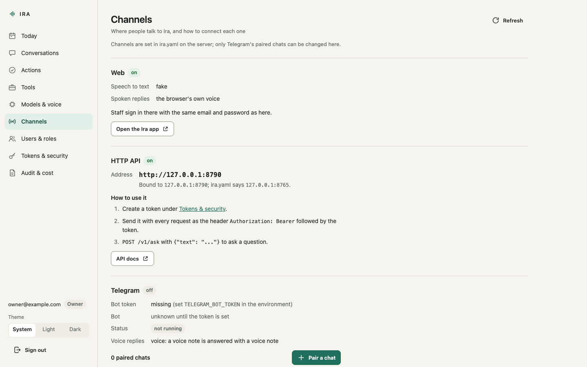

The web app, the HTTP API (with the address people actually open, which
`channels.http.public_url` or `IRA_PUBLIC_URL` sets behind a proxy) and
Telegram: the bot, its paired chats, **Pair a chat**, which gives you the
one-time `/pair` command to send to the bot, and Unpair. Also how to create
a token for the API and how to install the app on an Android phone or an
iPhone. Channels themselves are switched on in `ira.yaml`.

## Users and roles

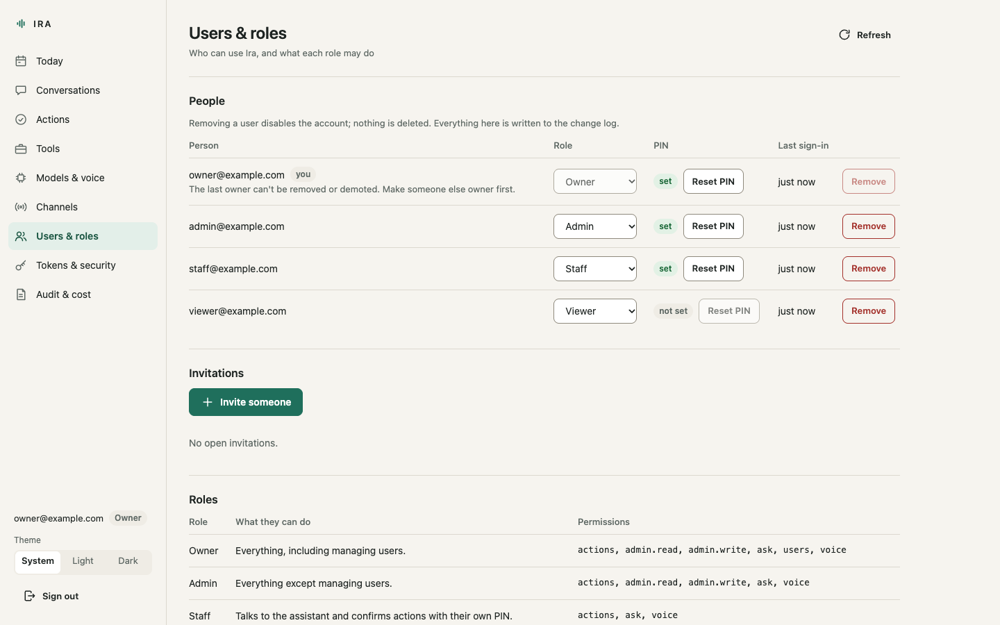

Owner only. Invite someone by email and role: the console shows the
invitation link once, for you to send yourself (IRA sends no email); it works
once and expires after 72 hours. Change a role, reset a PIN (the person sets
a new one in the Ira app), or remove a user, which disables the account and
revokes their sessions, tokens and Telegram chats while their history stays.
The last owner cannot be removed or demoted.

## Tokens and security

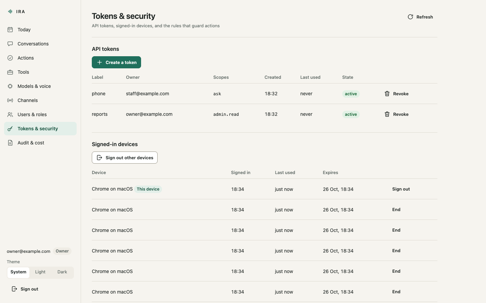

API tokens for programs: a label and scopes (`ask`, `voice`, `actions`,
`admin.read`) that can only narrow your own role; the token is shown once.
Signed-in devices ("Chrome on macOS"), with the option to end any session or
sign out everywhere else; the owner sees everyone's, with their role. Your own action PIN. And the rules the
server applies: how many wrong PINs lock actions and for how long, how long
a proposal waits, how long sessions last, and which roles may confirm which
actions.

## Audit and cost

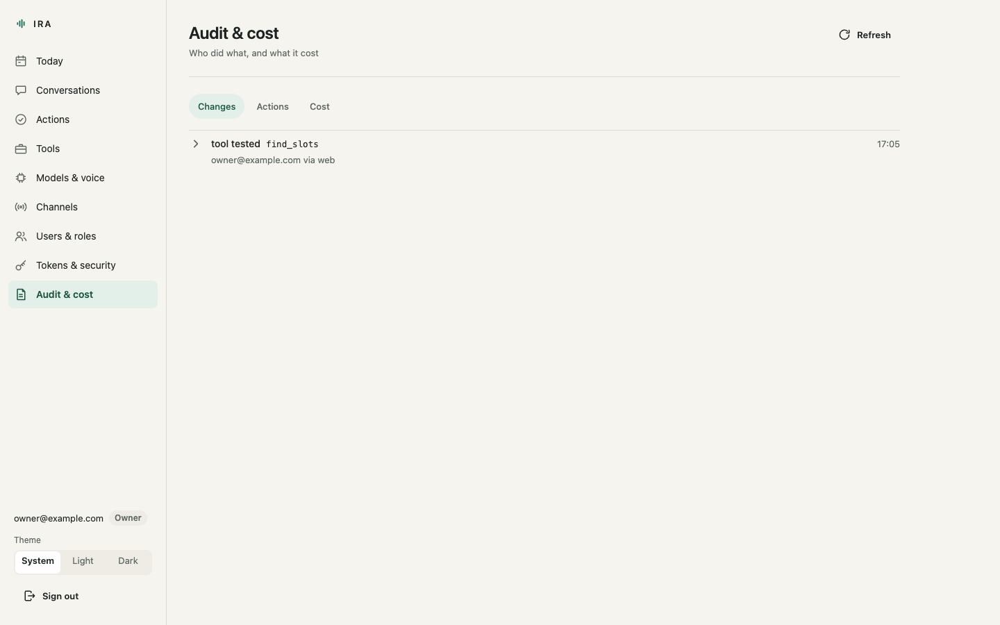

Three views. **Changes**: everything done from the console, with who did it
and the value before and after. **Actions**: every proposal and outcome,
with who and from which channel. **Cost**: calls, failures, tokens and cost
per day for the last 30 days, and every model call with the models tried,
the time and the cost. Model calls and the audit and change logs are kept
until you set days under `retention` in `ira.yaml`, which is cleaned every
hour. These pages read through a connection of their own, so a long
list never holds up a live call.

## The Ira app

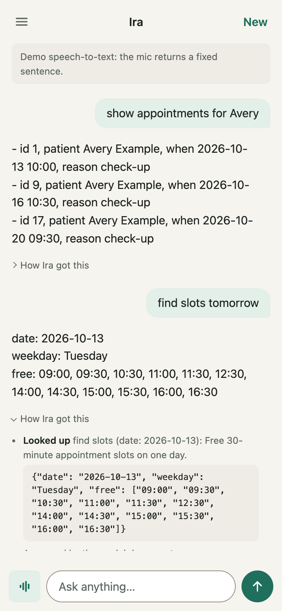

Everyone, staff included, uses the app at `/`. Its menu lists today's
conversations, has the switches for spoken replies and hands-free mode, and
is where each person sets or changes their own action PIN. The app installs
on a phone's home screen; the Channels screen has the steps.

## From the command line

Everything below is done with the `ira` command, run in the folder that holds
`ira.yaml` (or with `--config path/to/ira.yaml`, or `IRA_CONFIG`).

### First run

```bash
ira setup          # owner account; asks for email and password
ira pin set        # the owner's action PIN (4-12 digits)
ira serve
```

Without a terminal, start `ira serve` first: while no account exists it prints
a one-time setup code and a link that carries it
(`http://127.0.0.1:8765/admin/setup#code=...`, or `/#code=...` while no
console is built). The setup form and its endpoint stop working as soon as
the owner exists. See [Getting started](getting-started.md#set-up-from-the-browser-the-setup-wizard).

Both `ira setup` and `ira pin set` read from the terminal without echo. When
stdin is not a terminal they read one line from it, which is handy for
scripted installs:

```bash
printf '%s\n' "$OWNER_PASSWORD" | ira setup --email owner@example.com
```

### The address people open

`ira serve --host 0.0.0.0 --port 9000` overrides `channels.http` for that
run, and `GET /v1/admin/channels` reports what was really bound (the `http`
channel's `address.host` and `address.port`, next to `configured_host` and
`configured_port` from `ira.yaml`).

Behind a proxy, or to open Ira on a phone, tell the server where people
reach it:

```yaml
channels:
  http:
    public_url: https://ira.example.com   # or set IRA_PUBLIC_URL
```

`IRA_PUBLIC_URL` in the environment (or `.env`) wins over `ira.yaml`. The
value must be an `http://` or `https://` URL; a trailing `/` is dropped.
When it is set, the setup link that `ira serve` prints starts with it,
`POST /v1/admin/users/invites` returns the whole invitation link in `url`,
and the `http` channel's `address.public_url` and `address.url` carry it.

### Users and roles from the command line

| Role | For |
| --- | --- |
| owner | the business owner; everything |
| admin | a trusted manager; everything except user management |
| staff | reception, shop floor: ask, voice, confirm actions with the PIN |
| viewer | someone who only needs the dashboards |

Add the others from the command line (the password is read without echo):

```bash
ira user add --email desk@example.com --role staff
ira user add --email accountant@example.com --role viewer
ira user list
ira user password desk@example.com       # a new password; their sessions end
ira user email desk@example.com front@example.com
ira device code --email desk@example.com --days 7   # a pairing code for app reviewers
```

[A code for app reviewers](devices.md#a-code-for-app-reviewers) says when to
use the last one.

The console's Users & roles screen does the same, and more: invitations by
link, role changes, new passwords and emails, removals and PIN resets, each
written to the change log. Each person changes their own password and email
under **Tokens & security** (their password is asked again; their other
sessions are signed out).
See [Console API](api.md#console-api). The last owner can never be removed
or demoted.

Each person has their own **action PIN**:

```bash
ira pin set                            # the first owner's
ira pin set --user desk@example.com    # someone else's
```

People can also set their own with `PUT /v1/me/pin`, which asks for their
password again. Staff can propose an action and someone else allowed to
confirm it can enter their PIN on the same screen. Which roles may confirm
is set in `ira.yaml`:

```yaml
actions:
  confirm_roles: [owner, admin, staff]   # the default
  tools:
    cancel_appointment:
      confirm_roles: [owner]
```

`ira pin set` also lifts a wrong-PIN lock; a PIN set over the API does not.

### API tokens from the command line

Programs (a phone shortcut, a script, another service) use tokens:

```bash
ira token create --label phone --scope ask
ira token create --label reports --scope admin.read
ira token create --label kiosk --scope ask,voice --user staff@example.com
ira token list
ira token revoke phone           # by label or id
```

The token is printed once; only its SHA-256 hash is stored. Scopes are
`ask`, `voice`, `actions`, `observe`, `drop` and `admin.read`, and they can
only narrow the owning user's role. Writing settings and managing users always
need a signed-in session, never a token.

### Telegram

1. Create a bot with [@BotFather](https://t.me/BotFather) and copy its token.
2. Put the token in the environment (or `.env`) as `TELEGRAM_BOT_TOKEN`.
3. Enable the channel in `ira.yaml`:

   ```yaml
   channels:
     telegram:
       enabled: true
       token_env: TELEGRAM_BOT_TOKEN
       voice_replies: voice      # off | voice | always
   ```

4. Restart `ira serve`, then pair your chat:

   ```bash
   ira telegram pair              # or --user staff@example.com
   ```

   Send the printed `/pair CODE` to the bot within 10 minutes. The code works
   once and the bot deletes the message. The chat then acts as that user.

   The console does the same over the API: `POST /v1/admin/telegram/pairing`
   (a session with `admin.write`; another user's chat needs `users`)
   returns the code, `GET /v1/admin/telegram` lists the bot's `t.me` link
   and the paired chats, and `DELETE /v1/admin/telegram/chats/{chat_id}`
   unpairs one. Both writes go to the change log; the code never does.

Commands: `/help`, `/new` (fresh context), `/drop <text>` (put it in your
Drop; or send a file or photo with `/drop` as its caption, up to the 20 MB a
bot may fetch), `/cancel` (drop the pending action), `/name <new name>`
(owner or admin). New Drop items from the person's other devices come to
their chat (a file as a document, up to 45 MB), unless the server sets
`drop.telegram_forward: false` or they switch it off. To confirm an action, type the
PIN as a message on its own: the bot deletes it immediately and never sends it
to a model. A PIN said in a voice note is refused and that note deleted.

Group chats are ignored. Voice notes need the `ogg` extra or `ffmpeg`.

### Voice

Amazon Transcribe streaming, with Hindi and English told apart (and mixed
inside one recording, for Hinglish), signed with the server's AWS
credentials; the role needs `transcribe:StartStreamTranscriptionWebSocket`:

```yaml
voice:
  stt:
    type: transcribe
    region: ap-south-1
    languages: [hi-IN, en-IN]    # two or more: Transcribe identifies them
    identify: many               # many: switch inside a recording; one: one each
```

With no speech-to-text on the server, the Ira app can recognise speech in
the browser and send only the text (`voice.browser_stt`: `fallback`, the
default; `prefer` to use it always; `off` never). Chrome sends that audio to
Google; see [Privacy](privacy.md).

Amazon Transcribe streaming, for live calls (what `ira init --provider
bedrock` writes):

```yaml
voice:
  stt:
    type: transcribe
    region: ap-south-1
    languages: [hi-IN, en-IN]    # Hindi first: Hinglish comes back in Devanagari
    identify: one
```

Or an OpenAI-compatible model that takes audio, or Whisper:

```yaml
voice:
  stt:
    type: chat_audio             # or whisper
    provider: bedrock            # a provider defined under models.providers
    model: mistral.voxtral-small-24b-2507
    vocabulary: [Ira, Sunrise]   # names the transcriber should expect
  tts:
    type: polly                  # or openai
    voice: Joanna
    region: us-east-1
```

The browser mic needs a secure context: `http://127.0.0.1` works locally,
anything else needs HTTPS (see [Deployment](deployment.md)).

### Watching it over the API

The admin API gives the numbers a console needs; with a token of scope
`admin.read`:

```bash
curl -s -H "Authorization: Bearer $TOKEN" http://127.0.0.1:8765/v1/admin/overview
```

`overview` returns today's questions, model calls, failures, cost, tokens,
p50/p95 latency and a per-model breakdown; `calls`, `conversations`,
`actions`, `audit`, `tools`, `channels`, `users` and `tokens` list the
details. See [API](api.md).

- "Today" starts at the server's local midnight: the overview gives it as
  `since` and `since_iso`, with the server's `timezone`.
- `actions/counts?since=` counts actions by status over any span. A
  proposal past its expiry reads `expired` everywhere, never `pending`.
- The lists are paged: each answers with `X-Has-More: true|false`, and the
  next page is asked for with the last row's cursor (`before_id`, or
  `before` and `before_id`). See [Paging](api.md#paging).
- In the audit and change logs, `actor` is the person's email and
  `channel` where they were (`web`, `api`, `telegram`, `cli`).

### Backups

All state is in `data_dir` (default `./data`): `ira.db` plus whatever your
tools keep. Stop the server, or use `sqlite3 ira.db ".backup copy.db"`, and
copy the files. The data folder holds conversations and customer details:
treat backups as confidential.
