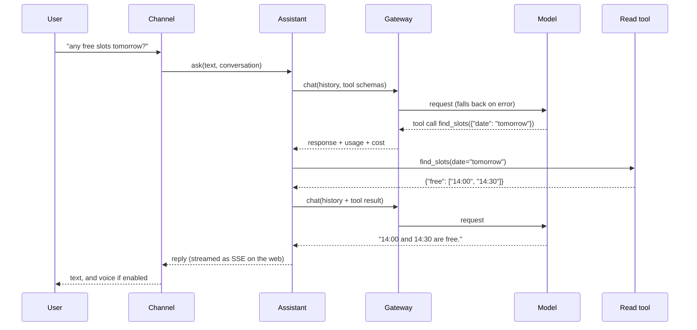

# Architecture

## Modules

```text
src/ira/
  models/          LLM gateway and providers
    base.py          provider-neutral messages, tool calls, usage, errors
    http.py          one HTTP client: auth objects, error mapping, key scrubbing, SSE lines
    openai_compat.py chat completions + tools + streaming (OpenAI, Mantle, local servers)
    anthropic.py     the Messages API + tool use + streaming
    aws.py           SigV4 signing via botocore's default credential chain (extra)
    fake.py          ScriptedProvider (tests) and RouterProvider (no-key demo)
    gateway.py       tiers, fallback, cool-downs, cost, the calls table
  tools/
    registry.py      @tool / @action, schemas from signatures, validation
    actions.py       pending actions, PIN check, lock, expiry, single execution, audit
    loader.py        import tool modules named in ira.yaml; setup/seed hooks
  voice/
    providers.py     chat_audio and Whisper STT; Polly and OpenAI TTS; fakes
    shorten.py       markdown -> speakable text, cut at a sentence
    audio.py         WAV checks, mono 16 kHz conversion, OGG/Opus decoding
  channels/
    http.py          FastAPI app: auth, ask, stream, voice, actions; web + admin mounts
    admin.py         /v1/admin read endpoints
    deps.py          bearer/cookie auth, CSRF header, permission checks
    schemas.py       request/response models (the OpenAPI document)
    telegram.py      Bot API client, pairing, the bot loop
  web/static/      the chat page, AudioWorklet recorder, service worker, manifest
  assistant.py     the conversation loop
  conversations.py history in SQLite
  accounts.py      users, roles, sessions, API tokens, sign-in throttling
  security.py      PIN, token and code hashing
  store.py         the SQLite schema and helpers
  config.py        ira.yaml + environment secrets
  runtime.py       builds everything from config
  cli.py           the ira command
```

## One turn



## An action

```mermaid
sequenceDiagram
    participant U as Owner
    participant A as Assistant
    participant M as Model
    participant Q as ActionGuard
    participant F as Action tool
    U->>A: "cancel appointment 3"
    A->>M: chat
    M-->>A: tool call cancel_appointment({"id": 3})
    A->>Q: propose(tool, validated args)
    Q->>Q: summary(), store pending, expiry = now + 120 s, audit "proposed"
    Q-->>A: pending action
    A->>M: tool result: "pending_confirmation, nothing has happened yet"
    M-->>U: "I've proposed: Cancel appointment #3 ... It needs your PIN."
    U->>Q: confirm(id, PIN)  (web card, API, or a typed PIN on Telegram)
    Q->>Q: locked? expired? PBKDF2 verify; UPDATE ... WHERE status='pending'
    Q->>F: cancel_appointment(id=3)  (exactly once)
    F-->>Q: result
    Q-->>U: "Done: Cancel appointment #3 ..."  + audit "executed"
```

The PIN goes from the owner straight to `ActionGuard`. It is never part of a
message history and never sent to a model.

## Data

One SQLite file (`<data_dir>/ira.db`) holds Ira's own state:

| Table | Holds |
| --- | --- |
| `users`, `sessions`, `api_tokens` | accounts; hashes only, never a password or token |
| `conversations`, `messages` | history, including tool calls and results |
| `calls` | one row per model request: model, tried, attempts, seconds, tokens, cost |
| `pending_actions` | proposals and their final status and result |
| `audit_log` | every action outcome, with actor and channel |
| `pin_state`, `settings` | wrong-PIN count, lock, PIN hash, assistant name |
| `telegram_chats`, `pairing_codes` | paired chats and one-time codes (hashed) |

Your tools keep their own data wherever they like; the clinic example uses a
second SQLite file.

## Design choices

- **SQLite and a lock, not a server.** One owner, a few staff, a few
  thousand messages a day: SQLite is plenty, and backup is a file copy.
- **Dataclasses inside, pydantic at the edges.** Config, tool arguments and
  the HTTP API are validated with pydantic; internal messages are plain
  dataclasses.
- **No SDKs for model providers.** Three small HTTP adapters keep the
  dependency list short and make the wire format testable with
  `httpx.MockTransport`.
- **No front-end build.** The web chat is plain JavaScript so it can be read
  and changed without a toolchain. The v0.2 admin console is the place for a
  framework.
