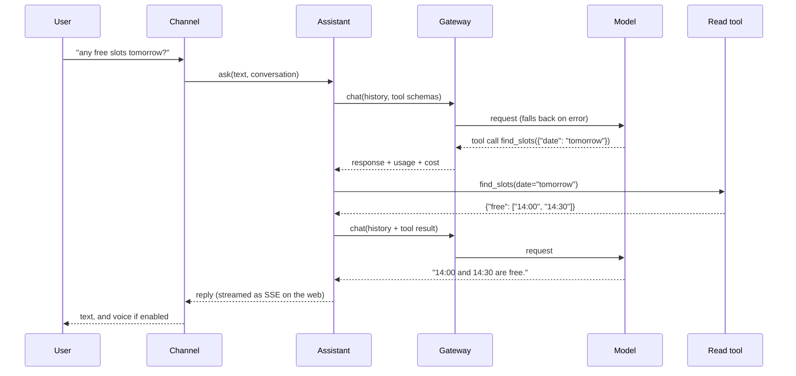
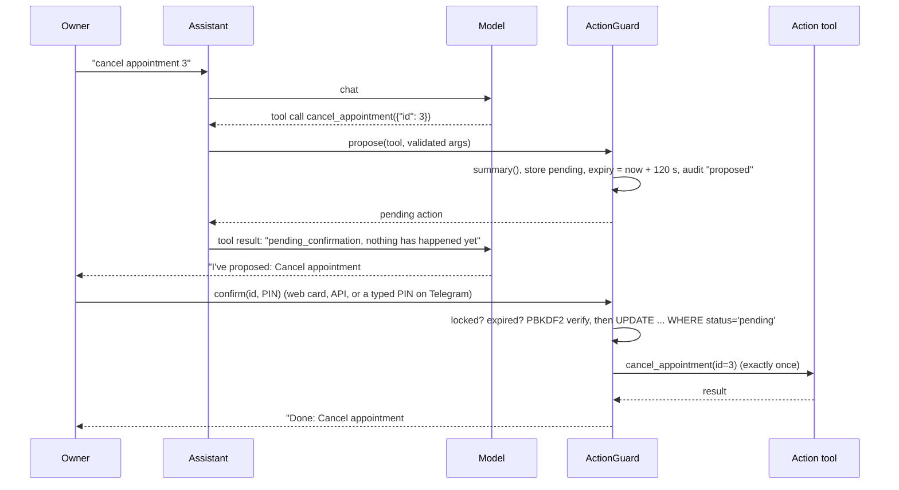

# Architecture

## Modules

```text
src/ira/
  models/          LLM gateway and providers
    base.py          provider-neutral messages, tool calls, usage, errors
    http.py          one HTTP client: auth objects, error mapping, key scrubbing, SSE lines
    openai_compat.py chat completions + tools + streaming (OpenAI, Mantle, local servers)
    anthropic.py     the Messages API + tool use + streaming
    aws.py           SigV4 signing via botocore's default credential chain (extra)
    fake.py          ScriptedProvider (tests) and RouterProvider (no-key demo)
    gateway.py       tiers, fallback, cool-downs, cost, the calls table
  tools/
    registry.py      @tool / @action, schemas from signatures, validation
    actions.py       pending actions, PIN check, lock, expiry, single execution, audit
    loader.py        import tool modules named in ira.yaml; setup/seed hooks
  voice/
    providers.py     chat_audio and Whisper STT; Polly and OpenAI TTS; fakes
    transcribe.py    Amazon Transcribe streaming STT over its WebSocket API
    shorten.py       markdown -> speakable text, cut at a sentence
    audio.py         WAV checks, mono 16 kHz conversion, OGG/Opus decoding
  channels/
    http.py          FastAPI app: auth, ask, stream, voice, actions; web + admin mounts
    account.py       first-run setup, invitations, your own PIN
    admin.py         /v1/admin read endpoints
    admin_write.py   /v1/admin writes: users, tokens, tools, model chains, settings
    deps.py          bearer/cookie auth, CSRF checks, permission and session-only checks
    schemas.py       request/response models (the OpenAPI document)
    telegram.py      Bot API client, pairing, the bot loop, device events to chats
    devices.py       pairing, the device WebSocket, your devices and events, downloads
    me.py            your settings, grants, what Ira did, export and delete
  devices/
    protocol.py      device frames and their limits
    store.py         devices, pairing codes, events (SQLite)
    hub.py           live connections, calls, events, each person's device tools
  web/static/      the Ira app: page, script, styles, tokens.css, AudioWorklet recorder,
                   service worker, manifest and icons
  web/admin/       the admin console's build (committed; source in admin/ at the repo root)
  assistant.py     the conversation loop: tiers, yes-confirmations, untrusted results
  search.py        web_search (Brave) and news_search (RSS), per person
  toollog.py       "What Ira did": every tool call, without contents
  usersettings.py  each person's assistant name, wake phrase, languages, web search
  clients.py       the Mac installer and the Chrome extension as zips
  conversations.py history in SQLite
  accounts.py      users, roles, sessions, API tokens, invitations, sign-in throttling
  changes.py       the change log of console writes
  overrides.py     console settings kept on top of ira.yaml: tool switches, chain order, name, voice
  security.py      PIN, token and code hashing
  store.py         the SQLite schema and helpers
  config.py        ira.yaml + environment secrets
  runtime.py       builds everything from config
  cli.py           the ira command
```

## One turn



## An action



The PIN goes from the owner straight to `ActionGuard`. It is never part of a
message history and never sent to a model.

## Data

One SQLite file (`<data_dir>/ira.db`) holds Ira's own state:

| Table | Holds |
| --- | --- |
| `users`, `sessions`, `api_tokens` | accounts and each user's PIN; hashes only, never a password, PIN or token |
| `invites` | one-time invitation links (hashed) with role and expiry |
| `change_log` | console changes: who, what, when, before and after |
| `conversations`, `messages` | history, including tool calls and results |
| `calls` | one row per model request: model, tried, attempts, seconds, tokens, cost |
| `pending_actions` | proposals and their final status and result |
| `audit_log` | every action outcome, with actor and channel |
| `pin_state`, `settings` | wrong-PIN count and lock; console overrides (assistant name, voice, tool switches, chain order) |
| `telegram_chats`, `pairing_codes` | paired chats and one-time codes (hashed) |
| `devices`, `device_pairings` | each person's devices (token hashed), their tools and skills; one-time pairing codes (hashed) |
| `device_events` | what devices announced, 7 days |
| `tool_log` | "What Ira did": tool, device, tier, outcome, seconds; never contents |
| `user_settings` | each person's preferences |

Your tools keep their own data wherever they like; the clinic example uses a
second SQLite file.

## Devices

```text
Chrome ── Ira extension ──native messaging──> in.ira.mac host ──unix socket──> ira-mac daemon
                                                                                    │
                                              WebSocket /v1/devices/ws, irad_ token │
                                                                                    ▼
             web app, Telegram, Android <──events── IRA server: hub, assistant, search
```

Each turn, the assistant offers the registry's tools plus the person's own:
their connected devices' tools whose skill is on, and web search if they
switched it on. What those return reaches the model wrapped as untrusted data.
The full picture is in [Devices](devices.md) and the [phase 1 design
note](design/phase-1-devices.md).

## Design choices

- **SQLite and a lock, not a server.** One owner, a few staff, a few
  thousand messages a day: SQLite is plenty, and backup is a file copy.
- **Dataclasses inside, pydantic at the edges.** Config, tool arguments and
  the HTTP API are validated with pydantic; internal messages are plain
  dataclasses.
- **No SDKs for model providers.** Three small HTTP adapters keep the
  dependency list short and make the wire format testable with
  `httpx.MockTransport`.
- **No front-end build for the app.** The Ira app is plain JavaScript so it
  can be read and changed without a toolchain, and it stays under 10 KB of
  script. The admin console is React and TypeScript in `admin/`, built with
  Vite into `src/ira/web/admin/`; the build is committed so `pip install`
  needs no Node, and CI checks that it matches the source. Both share one
  tokens file for colour, type and spacing.
