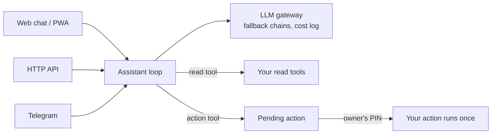

# IRA

**Hey Ira.** A self-hosted voice assistant over your own data and tools.

IRA lets a developer give a small business a voice and text assistant that
knows the business's own data: appointments, orders, stock, bookings. You
register *read tools* (functions that look things up) and *action tools*
(functions that change something). Ira answers on the web, over an HTTP API
and on Telegram, by text or voice. It only **proposes** an action; your code
runs it after the owner confirms with a PIN.

!!! note "Status: alpha"
    IRA is at v0.2: the Ira app, the admin console at `/admin` and the API
    behind them are all in. It runs end to end; the configuration and API may
    still change before 1.0.

## What you get

- **Any model.** OpenAI-compatible endpoints (local servers too), the
  Anthropic Messages API and Amazon Bedrock, in fallback chains with
  cool-downs.
- **Your own tools.** Typed Python functions; the signature is both the
  schema the model sees and the validation your code gets.
- **Actions behind a PIN.** A proposal with a human summary and an expiry,
  run exactly once after the PIN. The PIN never passes through a model.
- **Voice both ways.** A mic in the browser and Telegram voice notes in;
  spoken replies out. The transcriber is told to keep the language it hears
  and not to translate, which matters for Hinglish.
- **A log of every call.** Model, fallbacks tried, seconds, tokens and cost,
  never a key or a prompt.
- **An admin console.** Today at a glance, every conversation with the data
  each answer used, every action with who confirmed it, tools, models, users,
  tokens and cost, on a phone or a laptop.
- **Runs with no key.** A keyword-routing demo provider makes the example
  clinic work out of the box.
- **Your own assistant, too.** Install Ira for Mac, and Ira finds and reads
  your files, reads the window in front of you and your browser tabs, and
  searches the web and the news, for you alone, when you ask. See [Your own
  Ira](personal-assistant.md).

## Try it

```bash
git clone https://github.com/helloupendra/ira.git && cd ira
python3 -m venv .venv && source .venv/bin/activate
pip install -e .

cd examples/clinic
ira demo seed      # fictional appointments
ira setup          # owner email and password
ira pin set        # the PIN that releases actions
ira serve          # http://127.0.0.1:8765
```

Sign in, ask `find slots tomorrow`, then `cancel appointment 3` and confirm
it with the PIN. [Getting started](getting-started.md) has the details and
shows how to add a real model.

## How it fits together



## Where to go next

<div class="grid cards" markdown>

-   **[Getting started](getting-started.md)**

    ---

    Install, run the example clinic with no API key, then add a real model.

-   **[Concepts](concepts.md)**

    ---

    Tools, actions, the PIN, model tiers, conversations, roles and voice.

-   **[Architecture](architecture.md)**

    ---

    The modules, one turn and one action step by step, and the data model.

-   **[Admin guide](admin-guide.md)**

    ---

    Every console screen, then the `ira` command: users, tokens, Telegram,
    voice and backups.

-   **[Deployment](deployment.md)**

    ---

    HTTPS in front, a systemd service and cloud credentials.

-   **[API](api.md)**

    ---

    Ask, stream, voice and confirm from your own app; the admin read API.

-   **[Security](security.md)**

    ---

    What IRA protects, how, and what it does not do yet.

-   **[Sunrise Dental Clinic](examples/clinic.md)**

    ---

    A complete, fictional example: read tools, actions, summaries and tests.

</div>
