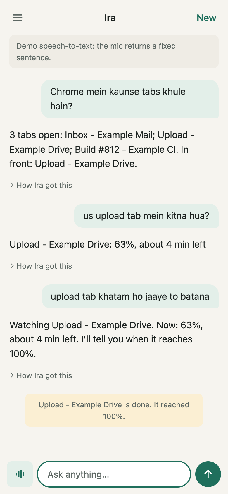
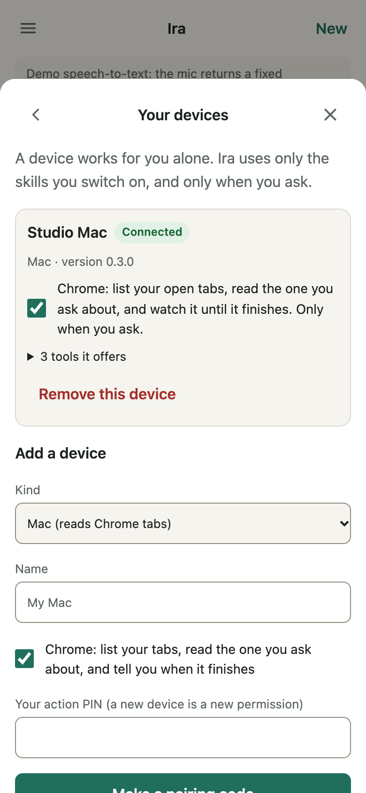
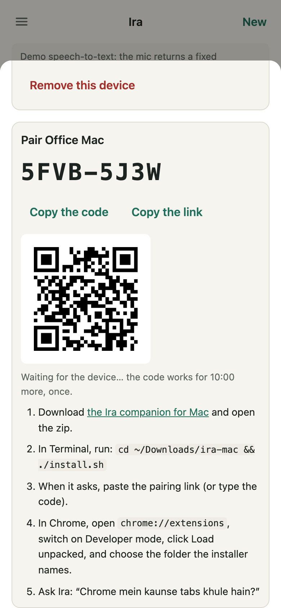
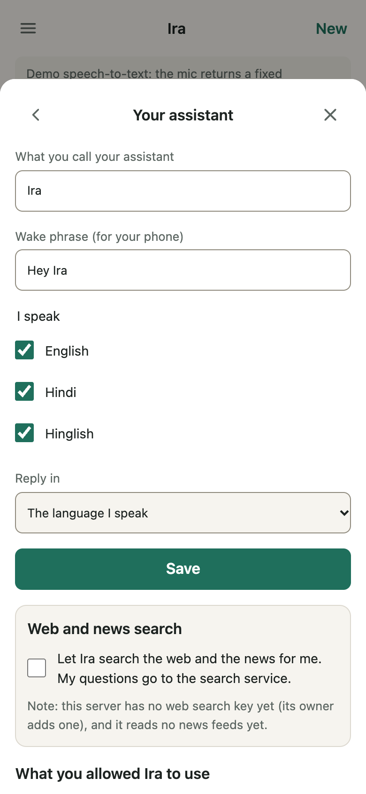
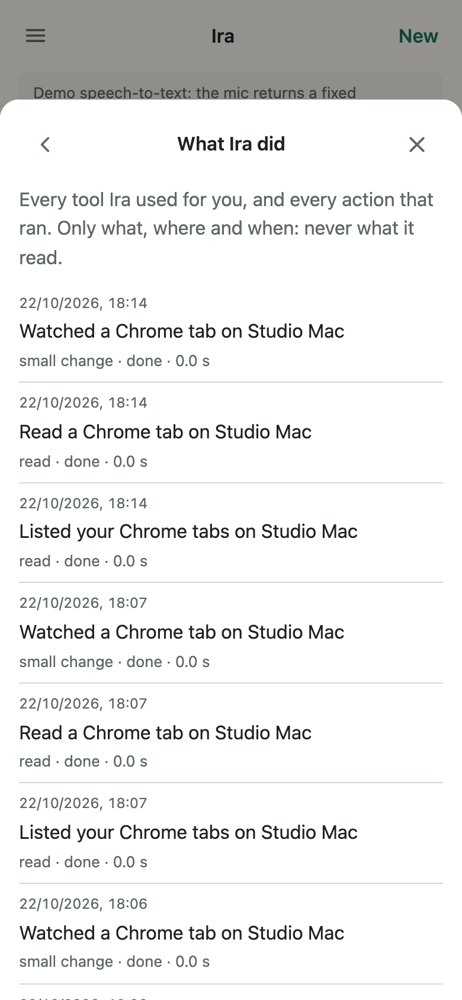
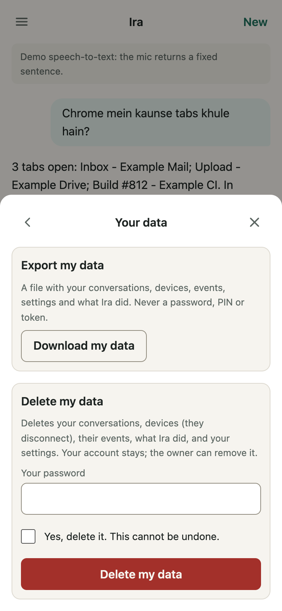

# Your own Ira, in 15 minutes

By the end of this page you can ask your own Ira, by typing or by voice:

> Chrome mein kya chal raha hai?

and Ira answers from the tabs open on your Mac. Then: "us upload tab mein
kitna hua?" ("The upload tab shows 63%, about 4 minutes left"), and "jab
khatam ho jaaye, batana": Ira watches the tab and tells you when it is done.

Ira works for you alone. It reads a tab only when you ask, only with the
skills you switch on, and never form fields or passwords. See
[Privacy](privacy.md) for exactly what is kept.

{ width="300" }

You need a Mac with Google Chrome, and about 15 minutes. No programming.

## 1. Start Ira (3 minutes)

Ira runs on your own computer or server. To try it on your Mac, open
**Terminal** (in Applications, Utilities) and paste these lines one at a time:

```bash
python3 -m venv ~/ira-app && source ~/ira-app/bin/activate
pip install "ira-assistant @ git+https://github.com/helloupendra/ira.git"
ira init ~/ira/me --business "my own work"
cd ~/ira/me && ira serve
```

The last command prints a link like
`http://127.0.0.1:8765/admin/setup#code=7F3A-91C2-0B4E`. Leave Terminal open.

!!! note "Someone else runs the server?"
    If your family or team already has an IRA server, skip this step: ask its
    owner for an invitation link, open it, choose a password, and go to
    step 3.

## 2. Make your account (2 minutes)

Open the link Ira printed. Choose your email and a password (10 characters
or more), give the assistant a name (Ira is fine), and set your **action
PIN**: 4 to 12 digits that only you know. Ira asks for this PIN whenever you
allow something new, such as a device.

Without a model key, Ira runs in **demo mode**: it understands simple
phrases like the ones on this page, but not free conversation. To give it a
real language model, see [Getting started](getting-started.md).

## 3. Add your Mac (5 minutes)

Open Ira at `http://127.0.0.1:8765`, sign in, open the menu (the three
lines, top left), and choose **Your devices**.

{ width="300" }

1. Under **Add a device**, keep **Mac**, give it a name, keep **Chrome**
   ticked, type your PIN, and press **Make a pairing code**.
2. Ira shows a code like `GUQC-6JSB`, a QR code, and the steps. The code
   works once, for 10 minutes.

{ width="300" }

3. Download **the Ira companion for Mac** (the link in step 1 of the card)
   and open the zip from your Downloads folder.
4. In Terminal, run:

    ```bash
    cd ~/Downloads/ira-mac && ./install.sh
    ```

    When it asks, paste the **pairing link** (the "Copy the pairing link"
    button), or type the code: a zip downloaded from your Ira already knows
    its address. The installer keeps this Mac's own key in your Keychain and
    starts the companion; it starts again by itself when you log in.

The card says **is paired** when it worked.

## 4. Add Ira to Chrome (3 minutes)

1. In Chrome, open `chrome://extensions`.
2. Switch on **Developer mode** (top right).
3. Click **Load unpacked** and choose the folder the installer named:
   `Library/Application Support/ira-mac/chrome-extension` in your home
   folder. (In the file chooser, press Cmd+Shift+G and paste
   `~/Library/Application Support/ira-mac/chrome-extension`.)
4. Click the puzzle piece in the toolbar, then the Ira icon: it says
   **Connected**.

## 5. Ask (2 minutes)

Back in the Ira app, type (or tap the mic and say):

- `Chrome mein kya chal raha hai?` or `Chrome mein kaunse tabs khule hain?`
- `us upload tab mein kitna hua?`
- `upload tab khatam ho jaaye to batana`

When the tab finishes, Ira writes a note in the app and says it aloud if
**Speak replies aloud** is on in the menu. If you paired Telegram, the note
arrives there too.

## Your assistant, your way

**Your assistant** in the menu: the name you call it, the wake phrase your
phone will listen for ("Hey Ira" by default), the languages you speak
(English, Hindi, Hinglish), the language it replies in, and web and news
search (off until you switch it on with your PIN). It also lists everything
you allowed Ira to use, each with **Turn off**.

{ width="300" }

**What Ira did** lists every tool it used for you and when: never what it
read. **Your data** lets you download everything Ira keeps about you, or
delete it.

{ width="300" }
{ width="300" }

## Talk to Ira like a phone call

When the server has a streaming speech-to-text and a voice set up, the Ira
app shows a phone button next to the text box. Tap it and just talk: Ira
answers as soon as you stop, and stops talking the moment you speak. Tap
**End call** when you are done. See [Real-time voice](realtime.md).

## Let Ira learn your routine (optional)

Off until you switch it on. Ira can notice when you leave the office or
start on your Mac, and after two weeks or more asks: "Shall I remember
this?" Only a yes makes it stick. See [What Ira learns](learning.md),
which also has the steps for an iPhone Shortcut.

## If something does not work

| You see | Do this |
| --- | --- |
| "Not paired: that code is used, expired or mistyped" | Make a new code on **Your devices** and run `./install.sh --pair` |
| The extension says "Not connected" | Run `./install.sh` again, then quit and reopen Chrome |
| Ira says "Chrome is not connected" | Open Chrome; check the extension is on in `chrome://extensions` |
| Ira says it "cannot read" a tab | Chrome does not let extensions read its own pages (`chrome://`), the Web Store or PDFs |
| The device shows "Last seen …" | In Terminal: `launchctl kickstart -k gui/$(id -u)/in.ira.mac` |

To remove everything from the Mac, run `./uninstall.sh` from the same
folder; it also tells Ira to forget this Mac. You can remove the Mac on
**Your devices** at any time: it stops working at once.

More detail: [the Mac companion](clients/mac.md) and [Devices](devices.md).
